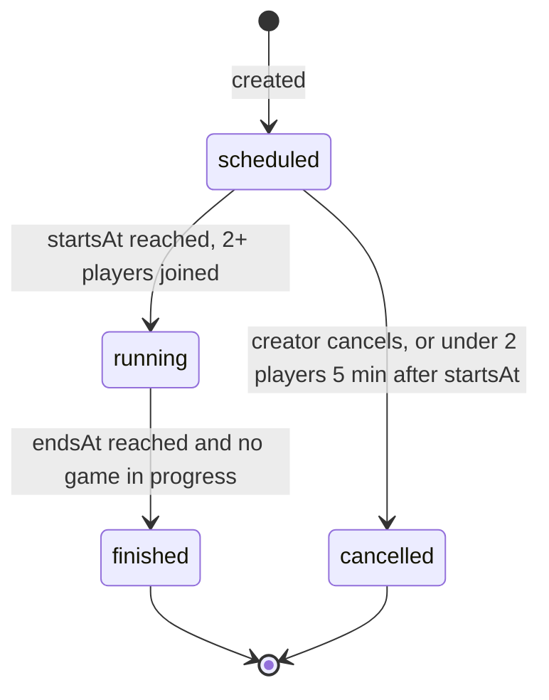

# Tournaments: architecture

Status: arena tournaments are built (migration 034), following this design
with the defaults in the table below. Where the code differs from a detail
here, "As built" at the end says how. Not built: reminders before the start,
berserk, private tournaments, Swiss.

## What to build first

**Arena tournaments.** A tournament runs for a fixed time (say 45 minutes).
Players join whenever they like, are paired with each other as soon as they
are free, and score points for every game. Most points when the clock runs
out wins.

Arena comes before Swiss or knockout because it fits what exists and it fits
a small player pool:

- It is matchmaking with a scoreboard. Pairing is the same "lock two waiting
  rows, create a game" transaction `MatchmakingService.pair` runs today.
- Nobody waits for a round to finish. With 4 to 10 players a Swiss round is
  held up by its slowest game, and one player leaving breaks the pairings.
- Late joiners and early leavers need no special handling.

The schema below carries a `format` column so Swiss can be added later
without a new set of tables.

## Decisions that are yours

These change the design, so they are worth settling before code is written.
Each has the default this document assumes.

| Decision | Default assumed here | Alternative |
| --- | --- | --- |
| Who can create a tournament | Any player, one upcoming or running tournament each | Only you (a script or an admin flag) |
| Rated | Yes: tournament games are ordinary rated games | Unrated, so nobody avoids tournaments to protect a rating |
| Games still going when the clock runs out | They count; the tournament closes when the last one ends | Lichess's rule: they are played out but don't count |
| Streak bonus | Yes: after two wins in a row a win scores 4 and a draw 2 | Plain 2 / 1 / 0 |
| Berserk (half your clock for an extra point) | Not in the first version | Add with the streak bonus |
| Private tournaments (link only) | Not in the first version; the share-token code makes it cheap later | In the first version |

## Lifecycle



A player's own state inside a tournament is separate: `active` (will be
paired), `paused` (stays in the standings, not paired) or `withdrawn`.

## Data model (migration 034)

```sql
CREATE TABLE tournaments (
  id serial PRIMARY KEY,
  "createdAt" timestamptz NOT NULL DEFAULT now(),
  "createdBy" integer NOT NULL REFERENCES users(id),
  name text NOT NULL,                     -- cleaned like chat text (src/game/chatText.ts)
  format text NOT NULL DEFAULT 'arena',   -- 'arena' now; 'swiss' later
  "time" integer NOT NULL,
  increment integer NOT NULL DEFAULT 0,
  rated boolean NOT NULL DEFAULT true,
  "startsAt" timestamptz NOT NULL,
  "endsAt" timestamptz NOT NULL,          -- startsAt + duration
  status text NOT NULL DEFAULT 'scheduled',
  "maxPlayers" integer NOT NULL DEFAULT 100,
  "playerCount" integer NOT NULL DEFAULT 0,   -- kept by join/withdraw, like users."listedGames"
  "winnerId" integer REFERENCES users(id),
  "finishedAt" timestamptz,
  CONSTRAINT tournaments_status CHECK (status IN ('scheduled','running','finished','cancelled')),
  CONSTRAINT tournaments_window CHECK ("endsAt" > "startsAt")
);
-- The lobby lists: what is on or coming up, and what a timer has to watch
CREATE INDEX tournaments_open_idx ON tournaments ("startsAt") WHERE status IN ('scheduled','running');
CREATE INDEX tournaments_finished_idx ON tournaments ("finishedAt" DESC) WHERE status = 'finished';

CREATE TABLE tournament_players (
  "tournamentId" integer NOT NULL REFERENCES tournaments(id) ON DELETE CASCADE,
  "userId" integer NOT NULL REFERENCES users(id),
  "joinedAt" timestamptz NOT NULL DEFAULT now(),
  status text NOT NULL DEFAULT 'active',  -- 'active' | 'paused' | 'withdrawn'
  score integer NOT NULL DEFAULT 0,
  streak smallint NOT NULL DEFAULT 0,     -- wins in a row, for the bonus
  games integer NOT NULL DEFAULT 0,
  wins integer NOT NULL DEFAULT 0,
  draws integer NOT NULL DEFAULT 0,
  "opponentRatingSum" integer NOT NULL DEFAULT 0,  -- tiebreak: performance rating
  "whites" integer NOT NULL DEFAULT 0,             -- colour balance
  "lastOpponentId" integer,                        -- no immediate rematch
  "waitingSince" timestamptz,   -- NOT NULL = in the pairing queue
  PRIMARY KEY ("tournamentId", "userId")
);
-- Standings page: an index scan, however many players
CREATE INDEX tournament_standings_idx ON tournament_players ("tournamentId", score DESC, "userId")
  WHERE status <> 'withdrawn';
-- The pairing pass reads only who is waiting
CREATE INDEX tournament_waiting_idx ON tournament_players ("tournamentId", "waitingSince")
  WHERE "waitingSince" IS NOT NULL;
-- "My tournaments"
CREATE INDEX tournament_players_user_idx ON tournament_players ("userId", "joinedAt" DESC);

ALTER TABLE games ADD COLUMN "tournamentId" integer REFERENCES tournaments(id);
CREATE INDEX games_tournament_idx ON games ("tournamentId", id) WHERE "tournamentId" IS NOT NULL;
```

Notes:

- There is no pairings table. A pairing is a game; the games of a tournament
  are `games WHERE "tournamentId" = …`, which is also each player's score
  sheet. Swiss will need full opponent history and can read it from there.
- The pairing queue is not a separate table either: it is the players whose
  `waitingSince` is set. One row to lock per player, and "who is waiting"
  can never disagree with "who is in the tournament".
- `games."tournamentId"` goes into `GAME_COLUMNS` and `GameResponse`, the way
  `seriesId` did.

## Backend pieces

| File | Responsibility |
| --- | --- |
| `src/game/arena.ts` | Pure rules, unit tested like `series.ts`: points for a result given the streak, the pairing of a list of waiting players, tiebreak order |
| `src/repositories/tournamentRepository.ts` | SQL: lock a tournament, read and lock waiting players, save scores, standings pages |
| `src/services/tournamentService.ts` | Create, cancel, join, pause, withdraw, start, pair, finish; publishes updates |
| `src/routes/tournaments.ts` | REST (below) |
| `src/routes/ws/tournament.ts` | The lobby socket |
| `src/services/gameService.ts` | `createGame` takes `tournament: { id }`, as it takes `series` |
| `src/services/liveGameService.ts` | `end()` calls `recordTournamentResult`; rematch, takeback and abort are refused for tournament games |
| `src/jobs.ts` | Backstop sweep for start, pairing and finish |
| `worker/index.ts` | `instanceFor` sends a tournament's socket to one instance by tournament id, as it does for a game |

### Pairing

One pass per running tournament, every 3 seconds while at least two players
are waiting (a timer on the instance that holds lobby sockets, with the
sweep in `jobs.ts` as backstop).

```mermaid
sequenceDiagram
    participant T as Pairing pass
    participant DB as Postgres
    participant H as RealtimeHub
    T->>DB: BEGIN; lock tournament row (FOR UPDATE SKIP LOCKED)
    Note over T,DB: Another instance holding it means a pass is already running: stop
    T->>DB: lock waiting players, best score first (SKIP LOCKED)
    T->>H: who still has a lobby or game socket? (memberUserIds)
    T->>T: arena.pair(): neighbours in the standings, not the last opponent
    loop each pair
        T->>DB: lockPlayers + findActiveGames (same as matchmaking)
        T->>DB: createGame(tournament), clear waitingSince
    end
    T->>DB: COMMIT
    T->>H: "pairing" to each player, "standings" to the lobby
```

Rules of `arena.pair()`:

- Sort the waiting players by score, then pair neighbours. Players near each
  other in the standings meet, which is what makes the top of an arena
  interesting.
- Skip a pair that just played each other when either has another neighbour
  to take. With two players waiting and nobody else, they play again.
- Never pair two players with a block between them (the same rule
  `opponentSql` applies in matchmaking).
- The player with fewer games as white gets white; a coin toss on a tie.
- An odd player out stays waiting and is first in line next pass.
- No pairing in the last `min(60 s, time)` before `endsAt`: a game that
  can't reasonably be played shouldn't start.

A player is waiting when they are `active`, have no game in progress, and
are connected: the lobby socket or a game socket of this tournament. Being
connected is checked at pairing time against the hub's membership set, so a
player who closed the tab simply stops being paired; no "leave" message is
needed and a crashed instance leaves nothing behind.

### When a game ends

In the transaction that ends the game (`LiveGameService.end`), next to
`recordSeriesResult`:

1. Lock both `tournament_players` rows, in user id order.
2. Add the points (`arena.points(result, streak)`), update streak, counters,
   `opponentRatingSum`, `lastOpponentId`.
3. Set `waitingSince = now()` for a player who is still `active`, so they go
   straight back into the queue. They stay on the game page and are sent to
   the next game when it is made.

After commit: the lobby gets a `standings` message, debounced to one every
two seconds per tournament.

**Lock order.** Every path that takes more than one of these takes them in
this order, so they queue instead of deadlocking:
`games` row → `tournaments` row → `tournament_players` rows (by user id) →
`users` rows (by id, as `lockPlayers` and `finishGame` already do). The end
of a game never needs the tournament row; pairing never locks an existing
game.

One lock in that list is taken by Postgres, not by the code: updating a game
row that was already written in the same transaction (a checkmating move, or
a game made unrated as it ends) checks its foreign key again and locks the
tournament's row `FOR KEY SHARE`, after the players' tournament rows. So the
tournament's row is locked `FOR NO KEY UPDATE` everywhere (`lock`, `tryLock`),
which that check doesn't conflict with. With `FOR UPDATE` a player joining or
leaving at the moment their game ended deadlocked with it.

### Changes to live games

For a game with a `tournamentId`:

- **No rematch, no takeback, no "give time".** Refused in `LiveGameService`
  with a clear error code; the buttons are hidden.
- **No abort.** A player who doesn't make their first move within
  `FIRST_MOVE_TIMEOUT_MS` (30 s) loses on time and is set to `paused`, so an
  absent player costs one opponent one short wait instead of being paired
  again and again. That game changes no ratings (nothing was played).
- **Draw offers** stay.
- Everything else (clocks, lag compensation, pause on shutdown, chat,
  spectating) is unchanged: it is an ordinary game.

### Start and finish

- **Start**: at `startsAt`, with at least two players joined, the tournament
  becomes `running` and everyone joined and connected gets `waitingSince`.
  With fewer than two it waits five minutes, then is cancelled.
- **Finish**: at `endsAt` pairing stops. When no game of the tournament is in
  progress the standings are final, `winnerId` is set and the lobby gets
  `finished` with the podium. A game can't outlast its clocks, so this is
  bounded; the sweep closes a tournament whose games are all over.
- **Timers** follow `LiveGameService.watchDeadline`: a per-tournament timer
  for start and end, armed when the tournament is created and again on
  startup from the `tournaments_open_idx` rows, with a sweep in `jobs.ts`
  that only runs while a tournament is open.

### The container sleeps

`Backend.sleepAfter` is 15 minutes and only open sockets keep it awake.

- During a tournament players hold sockets, so the timers fire.
- A tournament whose start time passes with nobody connected starts (or is
  cancelled) when the container next wakes: startup reads the open
  tournaments, as it reads live games' deadlines today. Nobody was there to
  miss it.
- What doesn't work without more: **a "starts in 5 minutes" push to players
  who joined and closed the tab**, if nobody else has the site open. That
  needs something outside the container to wake it. Two options, to decide
  when reminders are built: a Worker cron trigger that pings the backend
  only while a tournament is scheduled soon (the Worker would keep the next
  start time in KV or in the Durable Object's storage), or a Durable Object
  alarm on `Backend`. I have not verified the alarm API against
  `@cloudflare/containers` 0.3; check it before choosing.

### Several backend instances

Nothing here lives only in memory. The pairing pass is guarded by the
tournament row lock, so two instances running it at once pair nobody twice;
scores are written in the game's own transaction; messages go through the
hub, which already fans out over Redis. Routing a tournament's lobby sockets
to one instance (by tournament id) keeps standings broadcasts local, as
game sockets are today.

## API

REST, all signed in:

| Route | Purpose |
| --- | --- |
| `GET /api/tournaments?status=open\|finished&page=` | The list: running and upcoming first |
| `POST /api/tournaments` | Create: name, time, increment, startsAt, minutes, rated, maxPlayers. Limited to one open tournament per creator and a few a day |
| `GET /api/tournaments/:id` | The tournament, the top 20, the caller's own row |
| `GET /api/tournaments/:id/standings?page=` | The rest of the standings |
| `GET /api/tournaments/:id/me` | The caller's own line and game in progress (see "As built") |
| `GET /api/tournaments/:id/players/:userId/games` | One player's games (their score sheet) |
| `POST /api/tournaments/:id/join` · `/pause` · `/resume` · `/withdraw` | The caller's own state |
| `DELETE /api/tournaments/:id` | Cancel, by the creator, before it starts |

Socket `GET /api/ws/tournament/:id`, topic `tournament:<id>` plus the user's
own `tournament:<id>:user:<userId>`:

| Server sends | When |
| --- | --- |
| `state` | On connect and on `sync`: the tournament, top 20, own row, own game in progress |
| `standings` | Scores changed (debounced), with a version number so a client that missed one asks for `sync`, as study rooms do |
| `player` | The caller's own row changed |
| `pairing` | The caller has a game: `{ gameId }` |
| `started` · `finished` · `cancelled` | Lifecycle |

The client sends only `sync`; joining and pausing are REST calls, so they
work from the list page too.

## Frontend

- **Routes**: `/tournaments` (list and "Create tournament"), `/tournaments/:id`
  (the lobby). New feature folder `src/features/tournaments`.
- **Lobby**: name, clock and time control, a countdown to the start or the
  end, Join / Pause / Withdraw, the standings (rank, player, score, a row of
  small result digits per game, streak marked), the top game on a live board
  (the existing spectator view), and the podium once finished.
- **Staying paired without the lobby open**: a `TournamentSession` provider
  in `AppLayout` holds the lobby socket for the tournament the user is
  active in, so a `pairing` message navigates to the game from any page,
  the game page included. After a tournament game the post-game panel shows
  "Next game: pairing…" and "Back to tournament" in place of Rematch and
  New game.
- **Entry points**: a sidebar item, and a "Tournaments" card on Home showing
  what is running or next.
- **Later**: tournament results on the profile; a share link for a finished
  tournament using the share-page pattern (`/share/...`, public endpoint by
  token, Worker meta tags).

## Edge cases the design has to hold for

- **A player joins while in another game.** Allowed; they aren't waiting
  until that game ends (`findActiveGames` in the pairing pass is the guard).
- **A player is also in the matchmaking queue.** The pairing transaction
  deletes their queue row and open challenges, as `pair` does today.
- **Two players only.** They play each other repeatedly. Fine.
- **A player's account is deleted mid-tournament.** `deleteAccount` already
  resigns their live game; it also sets them `withdrawn`. Their row stays so
  opponents' scores still add up.
- **Restart or deploy during a tournament.** Games pause and resume as they
  do now; tournament state is all in Postgres; timers are re-armed on start.
- **Time runs out during a pairing pass.** The pass checks `endsAt` under the
  tournament lock, so no game starts after the cut-off.
- **Abuse.** Creation limits, a cleaned name, `maxPlayers`, and reports
  (the moderation table) can point at a tournament later.

## Build order

1. **Schema and rules**: migration 034, `arena.ts` with unit tests (points,
   streaks, pairing: no repeats when avoidable, odd player, blocks, colours).
2. **Service and game hooks**: create / join / start / pair / finish,
   `createGame` and `end()` changes, the live-game restrictions. Integration
   tests with fake users: a full tournament of four; two pairing passes at
   once; a no-show; a restart in the middle.
3. **REST and socket**, then the list and lobby pages.
4. **Auto-pairing from the game page** (`TournamentSession`), post-game panel.
5. **Polish**: Home card, push at start, profile results.
6. **Later**: reminders (needs the wake-up above), berserk, private
   tournaments, Swiss.

Steps 1 and 2 are the risky part and have no UI; they can be merged behind
the absence of any route that creates a tournament.

## As built

Differences from the design above, and details it left open:

- **One tick, no per-tournament timers.** `TournamentService.tick` (every
  3 s, from `src/jobs.ts`) starts, pairs and closes. It only runs while this
  instance knows of a tournament that is running or due (`needsTick`), so an
  idle server still asks the database nothing.
- **No socket topic per user and no "pairing" message.** A paired player gets
  the same `match_created` on their notifications socket that an accepted
  challenge sends, which the app already follows to the game from any page.
  The lobby socket sends `state`, `standings` and `tournament`, and
  `pairings` (the games a pass has just started, with their players' ids):
  the lobby is the socket a paired player is sure to have open, so a
  `match_created` that missed them doesn't cost them the game.
- **Being here** is the lobby socket, which the app holds open on the lobby
  page and on a tournament game's page. The game socket itself doesn't
  count.
- **A breather between games**: a player goes back into the queue 5 seconds
  after their game ends (`tournamentTimings.requeueDelayMs`).
- **The score sheet is stored** on the player's row (`sheet`, a digit per
  game), with a `performance` column for the tiebreak, so the standings
  never read the games.
- **A game that ends before both sides have moved** (a no-show, or a
  resignation on move one) is made unrated; it still scores in the
  tournament.
- **Leaving**: before playing, the player's row is deleted; after, it stays
  as `withdrawn` so opponents' points still add up. Joining again restores
  it with its score.
- **A push notification at the start** goes to the players who are in. A
  reminder *before* the start still needs the wake-up described under "The
  container sleeps".
- **API**: there is no `/resume` (joining again resumes) and no per-player
  games route yet. `GET /api/tournaments/:id` also returns `standingsTotal`.
- **A player below the lines the lobby is sent** (the top 20) doesn't fetch
  the lobby again on every `standings` message. The message carries
  `changed`, the ids of the players whose own line changed (their game
  ended; they joined, paused or left), and `GET /api/tournaments/:id/me`
  returns just the caller's line and game in progress. The client asks for
  it at once when it is named, and otherwise at most every 30 seconds (its
  place may have moved because others scored).
- **An account being deleted can't join again.** `join` and `create` hold
  the user's row `FOR KEY SHARE` and refuse one whose Clerk id is gone
  (`holdAccount`), and `deleteAccount` leaves the tournaments once more
  after the account is gone, for anything joined or set up while the
  deletion ran. Either the join commits first and that sweep finds it, or
  it is refused.
- **Creation limit**: one open tournament per creator (the unique index) and
  `TOURNAMENTS_PER_DAY` (10) a day, counted in Redis when the insert has
  succeeded; over it the answer is 429 `TOURNAMENT_RATE_LIMITED`.
- **A first move sent after its deadline** ends the game the way the deadline
  timer would (the late player loses and is paused); it is never aborted.
- **The startup read of the open tournaments is tried again** by the tick
  until it succeeds (`needsTick` stays true meanwhile), as the live games'
  deadlines are.
- **A lobby socket that closes while it is being opened** is not attached
  (`RealtimeHub.attach` ignores a closed socket), so it can't leave the
  player counted as here.
